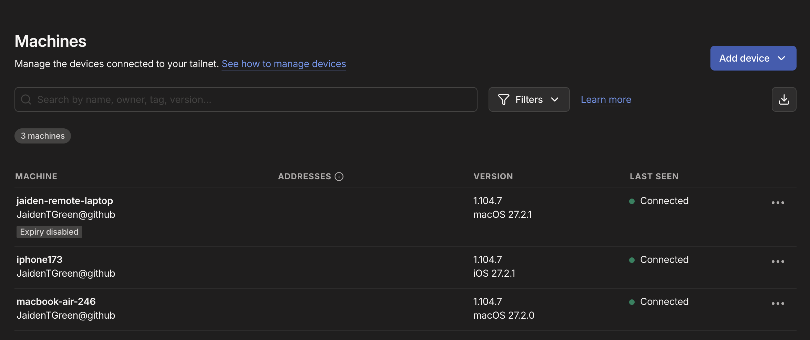
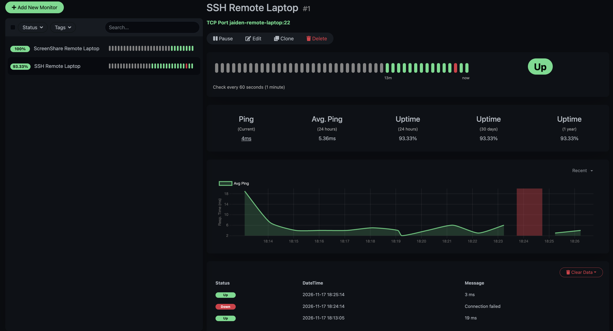

# 02 – Remote Access and Containers
 
## Goal
 
After Phase 1, the server could run headless, but I still needed the KYY monitor or my home Wi-Fi to do anything with it. The goal of this phase was to manage the server securely from anywhere, without opening ports on my router, and to run my first service on it.
 
---
 
## Connecting Over SSH
 
I turned on Remote Login in Phase 1, so the first step was connecting from my main Mac. My computer name has underscores (`Jaiden_Remote_Laptop`), which aren't allowed in network names, so macOS converted it to `Jaiden-Remote-Laptop.local`.
 
```
user@workstation ~ % ssh user@server.local
The authenticity of host 'server.local (<ip>)' can't be established.
ED25519 key fingerprint is: SHA256:bLsW...
```
 
### Verifying the Host Fingerprint
 
On the first connection, SSH shows the server's fingerprint and asks whether to trust it. I compared it with the server's actual key:
 
```
user@server ~ % ssh-keygen -lf /etc/ssh/ssh_host_ed25519_key.pub
256 SHA256:bLsW... no comment (ED25519)
```
 
The fingerprints matched. 
**Note:** I ran this check over the same SSH connection I was trying to verify. If someone were impersonating the server, they could fake this output too. A truly independent check would be done on the machine itself with a monitor and keyboard. On my home network the risk is very low, but it's important to know the difference.
 
> **Lesson:** A verification is only as trustworthy as the channel you run it over.
 
---
 
## Key Based SSH Authentication
 
Passwords can be easily guessed or obtained, so I switched to a key only login.
 
1. Generated an ed25519 key with a passphrase on my main Mac (`ssh-keygen -t ed25519`)
2. Installed the public key on the server with `ssh-copy-id`
3. Added a `homelab` shortcut to `~/.ssh/config`, with the macOS Keychain remembering the passphrase
4. Disabled password login in `/etc/ssh/sshd_config.d/000-hardening.conf`:
```
PasswordAuthentication no
KbdInteractiveAuthentication no
PermitRootLogin no
```
 
- I named the file `000-` on purpose. SSH uses the **first** value it reads for each setting, so my file has to load before macOS's default config.
- I checked the config with `sudo sshd -t` and kept a second session open in case I locked myself out.
### Proof
 
```
user@workstation ~ % ssh -o PubkeyAuthentication=no homelab
user@server: Permission denied (publickey).
```
 
With the key turned off, the server refuses the connection, so password login really is disabled.
 
> The private key never leaves my main Mac and is never committed to GitHub. Only the `.pub` file is safe to share.
 
---
 
## Remote Access From Anywhere (Tailscale)
 
To reach the server away from home without port forwarding, I set up Tailscale, a private mesh VPN. Only devices signed into my account can see each other.
 
- Installed the standalone version on the server (the server is signed out of iCloud, so the App Store wasn't an option), plus my main Mac and my phone
- Turned on **Start at login** so the server reconnects after reboots
- Pointed my `homelab` SSH shortcut at the server's Tailscale name
- Tested SSH and Screen Sharing from my phone's hotspot, completely off my home network. Both worked.
**Decision: key expiry.** Tailscale makes devices sign in again about every 180 days. If the server's key expired while I was away, I'd lose access until I got home. I disabled key expiry **on the server only**. The tradeoff is that if the server were ever stolen or compromised, its access wouldn't expire on its own, so I'd have to remove it manually. My main Mac and phone leave the house, so I kept expiry on for them.
 

 
---
 
## Containers (OrbStack + Uptime Kuma)
 
I installed OrbStack to run Docker containers and chose Docker over Kubernetes, which would be too much for my 8GB machine. My first container is **Uptime Kuma**, which checks every 60 seconds whether my services are up.
 
```
docker run -d --name uptime-kuma --restart unless-stopped \
  -p 3001:3001 -v uptime-kuma:/app/data louislam/uptime-kuma:2
```
 
Monitors:
- **SSH**: TCP port 22
- **Screen Sharing**: TCP port 5900
### Problems
 
- **Keychain over SSH.** Image downloads failed over SSH because Docker checks the macOS Keychain for credentials, and macOS blocks Keychain access in SSH sessions, even after unlocking it. I downloaded the image from Terminal through Screen Sharing instead. The other fix, removing Docker's keychain setting, would store any future registry logins in a plain file, so I didn't do that.
- **Outdated image.** My first install used the `latest` tag, and Uptime Kuma warned that `latest` still points to v1, which no longer gets security fixes. Since nothing was set up yet, I deleted the container, its volume and the old image, and reinstalled with the `:2` tag.
> **Lesson:** Never trust the `latest` tag. It can point to an old, unmaintained version and can change without warning. Pinning a version tag means I know exactly what I'm running.
 
### Testing That Monitoring Works
 
An dashboard that shows all green doesn't prove much, so I tested a failure. I turned off Remote Login through Screen Sharing, which doesn't depend on SSH. The SSH monitor went **Down** ("Connection failed") within a minute, and came back **Up** after I turned Remote Login back on.
 

 
### Notes for Later
 
- Uptime Kuma listens on every network (`0.0.0.0:3001`), meaning my home Wi-Fi and Tailscale. It's not exposed to the internet, but I plan to restrict it to Tailscale during hardening.
- Uptime Kuma runs on the same server it monitors. If the whole server goes down, it can't alert me. An outside check, like a "dead man's switch" service, would fix that.
---
 
## Recovery Plan
 
- **Lost my main Mac (and SSH key):** connect with Screen Sharing, which still uses my password, and add a new key
- **Lost network access:** plug in the external monitor and a keyboard
---
 
## What I Learned
 
- **Keys beat passwords**, and config file order matters. A setting can silently not apply if another file loads first.
- **Every convenience is a tradeoff.** Disabling key expiry and skipping the Docker keychain workaround were both deliberate choices, and I documented why I made those choices.
---
 
## Next Steps
 
- Harden the server against the CIS macOS benchmark
- Restrict Uptime Kuma to Tailscale only
