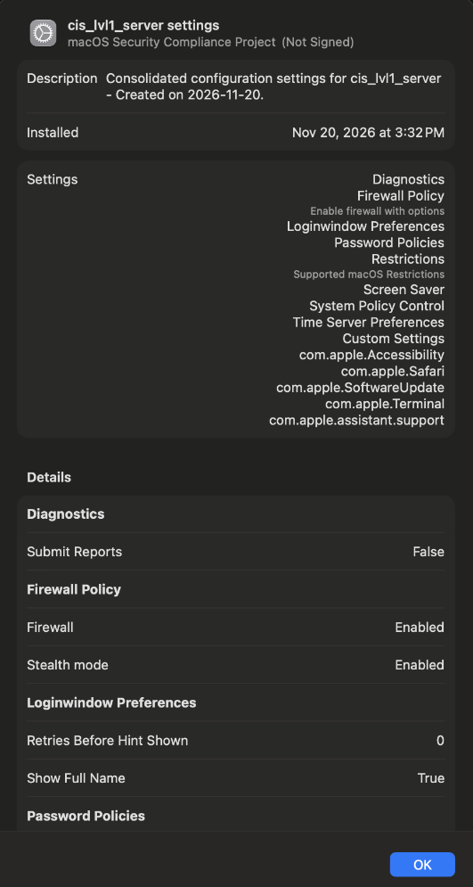

# 03 – CIS Hardening
 
## Goal
 
With remote access working, my next step was hardening the server against an industry standard instead of guessing settings. I wanted a measurable before and after my changes: an audit score, and network scans that show what an attacker could actually see.
 
---
 
## Choosing the Benchmark
 
My server runs **macOS 27.2.1**, but the newest official CIS benchmark is for macOS 26 Tahoe. Instead of implementing an older version's guide by hand, I used NIST's **macOS Security Compliance Project (mSCP)**. It maps security rules to frameworks including CIS, and it already supports CIS Level 1 for macOS 27.
 
mSCP generates a compliance script that can audit every rule (`--check`) without changing anything. That gave me a repeatable score to measure each change against.
 
> This is NIST's mapping of the CIS Level 1 controls, not the official CIS benchmark document.
 
---
 
## Baseline Network Scans
 
Before altering, I scanned the server from my main Mac with Nmap. This also serves as the "before" for my attack validation phase later.
 
```
nmap -sV -p- <tailscale-server-name> -oN nmap-before-tailscale.txt
nmap -Pn -sV -p- <lan-server-ip> -oN nmap-before-lan.txt
```
 
| Port | Service | Notes |
|---|---|---|
| 22 | SSH | Expected |
| 88 | Kerberos (`kdc`) | Not something I knew I turned on |
| 3001 | Uptime Kuma | Nmap guessed "nessus?" from the port number. The fingerprint showed `<title>Uptime Kuma</title>`. |
| 5900 | Screen Sharing | Expected |
| 54449 | Tailscale peer service | Tailscale network only |
 
### Problems Along the Way
 
- **`.local` names don't work in Nmap.** Nmap uses its own name lookup, so I found the server's LAN IP with `ping` and scanned that instead.
- **"Faster" was slower.** With `-T4`, the LAN scan slowed to 0.42% after 9 minutes. Over Wi-Fi, too many probes went unanswered and Nmap kept backing off. The default timing finished in about 52 minutes.
- **A firewall difference that wasn't real.** Unused ports showed "closed" over Tailscale but "filtered" on the LAN. My first thought was that the firewall treated the networks differently. A slow re-scan of ports 1–100 (`--max-rate 20`) showed them answering "closed" on the LAN too. macOS was limiting the rate its replies to the fast scan.
- **The router renamed my server.** `hostname` showed a router assigned name instead of the one I set, so I set it back with `sudo scutil --set HostName`.
> **Lesson:** Test your first theory before writing it down. A slow, isolated re-scan disproved what looked like a firewall finding.
 
---
 
## Investigating Port 88
 
Port 88 behaved inconsistently between scans, so I looked at what was behind it:
 
```
user@server ~ % sudo lsof -nP -iTCP:88
COMMAND PID USER   FD   TYPE  ...  NAME
kdc     170 root    5u  IPv6  ...  TCP *:88 (LISTEN)
```
 
It was macOS's built-in Kerberos service: running as **root**, started at boot, and listening on **every network**. That's attack surface, even if it's Apple's. I came back to it at the end of this phase.
 
---
 
## Baseline Audit
 
I generated the CIS Level 1 baseline (97 rules) and compliance script in mSCP's Docker container, then ran a check-only audit:
 
```
sudo zsh ./cis_lvl1_macos_27.0/cis_lvl1_macos_27.0_compliance.sh --check
```
 
**Baseline score: 27 of 96 checks passed (28%).**
 
While investigating, I also listed which programs the firewall allowed to accept connections. There were 14, including `python3`, `ruby` (any script could open a listening port), `cupsd` (printing) and `smbd` (file sharing). "Automatically allow downloaded signed software" was also enabled.
 
---
 
## Group 1: Network Exposure (27 → 28)
 
- Turned on firewall **stealth mode**
- Turned off automatic firewall access for downloaded signed software
- Removed firewall permissions for `python3`, `ruby`, `cupsd`, `smbd` and `sharingd`
- Disabled the file sharing service: `sudo launchctl disable system/com.apple.smbd`
The firewall commands printed nothing, so I confirmed each change with `--getstealthmode`, `--getallowsigned` and `--listapps`. The allowed list went from 14 programs to 11, then 9.
 
### Why the Score Barely Moved
 
mSCP is built for company managed Macs. Many of its checks look for a **management profile that enforces a setting**, not whether the setting is currently on. My firewall, stealth mode and Gatekeeper (`spctl --status` showed "assessments enabled") were all on but still "failed."
 
---
 
## Group 2: Tailored Configuration Profile (28 → 69)
 
mSCP can generate configuration profiles that enforce settings. But CIS Level 1 includes rules that would break my server, so I **tailored the baseline** by copying it and removing four rules before generating one consolidated profile:
 
| Removed rule | Why |
|---|---|
| Disable automatic login | The server needs auto-login to recover after reboots |
| Prevent disabling FileVault | FileVault is off by design (an accepted exception) |
| Maximum password age | NIST SP 800-63B advises against forced periodic password changes, and an expired password could stall auto-login |
| Login window banner text | The check expects CIS's placeholder text ("Center for Internet Security Test Message") |
 
I keep **auditing against the full CIS baseline**, so these still show up as honest failures. I only **enforce** the tailored version.
 
### Before Installing
 
- **Safety check:** I searched the generated profile for the four removed settings to make sure none were hiding in it.
- **Reviewed the values:** minimum password length 15, lockout after 5 failed attempts, screensaver after 15 minutes, screen lock 5 seconds after that.
- **Fixed a gap:** the profile set a lockout limit but no lockout duration. With me as the only admin, a few typos could have locked me out indefinitely. I added `minutesUntilFailedLoginReset` = 15 (matching CIS guidance) and validated the file with `plutil -lint`.
- **Changed my password first:** mine was 11 characters, so I changed it to 16 **through System Settings** (so the login Keychain updated too), then re-checked auto-login and ran a reboot test.


 
### A Tooling Surprise
 
After installing the profile, the audit returned **0**. The compliance script was gone: re-running the generator with only the profile options had rebuilt the output folder and deleted it. I regenerated everything in one command (`-s -p`) and the real score was **69**.
 
> **Lesson:** Generate all outputs in one run, and when a result looks impossible, check the tool before trusting the number.
 
---
 
## Group 3: Services and sudo (69 → 75)
 
- Disabled Remote Apple Events, wake-for-network, NFS, and Bluetooth sharing
- Hardened sudo so it asks for a password every time and logs every command:
```
Defaults timestamp_timeout=0
Defaults log_allowed
```
 
A broken sudoers file can lock you out of `sudo` entirely, so I validated it with `visudo -cf` before installing it, then confirmed sudo still worked with `sudo -k` and `sudo whoami`.
 
---
 
## Group 4: Audit Logging (75 → 81)
 
These rules turn on macOS's security audit trail (`auditd`), lock down its files, and set retention (60 days or 5 GB). Instead of writing the fixes from memory, I extracted **NIST's exact fix code** from the generated script, read each one, and only then ran it:
 
```
runfix audit_auditd_enabled
--- audit_auditd_enabled will run:
...
Run it? (y/n)
```
 
```
user@server ~ % sudo audit -c
audit condition: 1 (AUC_AUDITING)
```
 
This audit trail is what my SIEM (Wazuh) will collect in a later phase.
 
---
 
## Group 5: Permissions and Authorization (81 → 84)
 
- Made home folders private
- Required an admin password to change system-wide settings (Network, Sharing, Software Update and others)
- Only the session owner can unlock a locked session
The last two change macOS's authorization database, which is harder to undo than a file, so I **backed up all nine affected entries** first. Then I tested locking and unlocking the screen.
 
I also turned on all automatic update settings. The audit still fails those rules, most likely because macOS 27 manages them through Apple's declarative device management, which needs an MDM server.
 
---
 
## Closing Port 88
 
My plan was to block `kdc` in the firewall, but macOS refused:
 
```
Firewall settings cannot be modified from command line on managed Mac computers.
```
 
The profile was now enforcing the firewall, so even an admin with `sudo` couldn't change it. That's the tamper resistance I wanted. Instead, I stopped the service itself:
 
```
sudo launchctl disable system/com.apple.Kerberos.kdc
sudo launchctl bootout system/com.apple.Kerberos.kdc
```
 
SSH doesn't depend on Kerberos, so I had a way back if something broke. Screen Sharing still worked over both networks, and `kdc` stayed off after a reboot. Over the LAN, Screen Sharing now takes longer to connect, likely because my Mac tries Kerberos first and waits for it to time out. I mostly connect over Tailscale, so I accepted that.
 
## Restricting Uptime Kuma
 
I recreated the container bound to the server's Tailscale address instead of `0.0.0.0`:
 
```
-p <tailscale-server-ip>:3001:3001
```
 
It loads over Tailscale, fails over home Wi-Fi, and came back on its own after a reboot.
 
---
 
## Results
 
### Audit Score
 
| Stage | Passing |
|---|---|
| Baseline | 27/96 (28%) |
| Group 1: network exposure | 28 |
| Group 2: tailored profile | 69 (72%) |
| Group 3: services and sudo | 75 (78%) |
| Group 4: audit logging | 81 (84%) |
| Group 5: permissions | **84/96 (87.5%)** |
 
### Network Exposure (Home Wi-Fi)
 
| Port | Before | After |
|---|---|---|
| 22 SSH | open | open (needed) |
| 88 Kerberos | open | **filtered** |
| 3001 Uptime Kuma | open | **gone** (Tailscale only) |
| 5900 Screen Sharing | open | open (needed) |
 
### Network Exposure (Tailscale)
 
| | Before | After |
|---|---|---|
| Open ports | 22, 88, 3001, 5900, 54449 | 22, 3001, 5900, 54449 |
| Unused ports | answered "closed" | **silent** (stealth mode) |
| Host discovery | found normally | **"Host seems down"** without `-Pn` |
| Full scan time | ~13 min | ~53 min |
 
Stealth mode doesn't just hide ports. It made the server look offline to a default scan and about four times slower to map.
 
### The 12 Remaining Failures
 
| Rules | Reason |
|---|---|
| FileVault (2 rules) | Accepted exception: needed for unattended reboots. The server stays at home and holds no personal data. |
| Automatic login | Accepted exception: lets the server recover after reboots |
| SSH, Screen Sharing, remote management | Accepted exceptions: how I manage the server |
| Maximum password age | Accepted exception: NIST advises against forced expiry |
| Login banner text | The check expects CIS's placeholder text |
| Software updates (3 rules) | Turned on, but likely needs MDM to enforce |
| External volume encryption | **Tool bug** (below) |
 
### A Bug in the Audit Tool
 
`os_external_apfs_hfs_volumes_encrypted` failed even though `diskutil list external` showed no external drives. Reading the check code showed why: with no drives, the result is empty, and it's compared to `"Yes"`. Even an encrypted drive would print text like `MyDrive  Encrypted`, which also doesn't equal `"Yes"`. **This check can't pass on a Mac with no external drives.**
 
---
 
## What I Learned
 
- **A score is a tool, not the goal.** My final 87.5% says more than 100% would, because every remaining failure is a documented decision.
- **Verify the tool too.** Missing scripts, profile-based checks and a buggy rule all showed the score can be wrong.
- **Read fix code before running it as root**, especially fixes that change the authorization database or sudo.
- **Have a way back.** Backups, validation (`visudo`, `plutil`) and a second access path made every risky change reversible.
---
 
## Next Steps
 
- Vulnerability scanning with Nessus Essentials
- Record my exceptions as mSCP exemptions, so the audit output shows the reason next to each failure
- Report the external-volume check bug to the mSCP project
 
