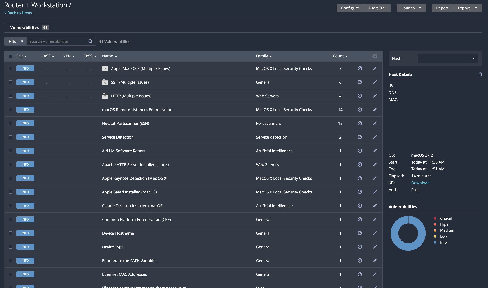
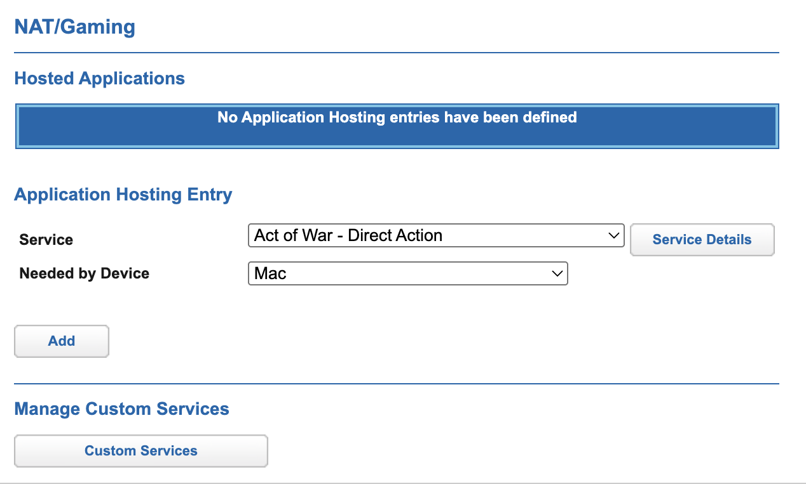

# 04 – Vulnerability Management
 
## Goal
 
Hardening showed what the server's settings were. This phase answered a different question: **what known vulnerabilities exist on the devices on my network, and which ones actually matter?** I wanted to run a real scan, triage the findings instead of fixing everything blindly, fix what I could, and confirm the fixes with rescans.
 
---
 
## Setup: Nessus Essentials
 
I installed Nessus Essentials on my **main Mac**, not the server. It needs about 4 GB of RAM, and scanning across the network is closer to how a real attacker sees the server.
 
The free tier has changed from what most guides describe:
 
| Limit | Effect on this project |
|---|---|
| 5 IP addresses | Enough for the server (LAN + Tailscale), router and workstation |
| 30-day license | Planned the phase to finish within it |
| 30-day delayed plugin feed | Vulnerabilities published in the last month aren't detected |
| No exports | Findings tracked manually in [`findings/vulnerability-tracker.md`](../findings/vulnerability-tracker.md) |
 
### Verifying the Install
 
The installer had already been removed before I could check its checksum, so I verified the installed program's code signature instead:
 
```
user@workstation ~ % codesign --verify --verbose /Library/Nessus/run/sbin/nessusd
/Library/Nessus/run/sbin/nessusd: valid on disk
/Library/Nessus/run/sbin/nessusd: satisfies its Designated Requirement
```
 
Next time I'd compare the download's SHA-256 checksum **before** installing.
 
Nessus uses a self-signed certificate, so Chrome warned about the connection. I only accepted that for `localhost`, my own machine talking to itself.
 
---
 
## Scan 1: The Server (Uncredentialed)
 
I scanned the server's LAN and Tailscale addresses without credentials, which shows what an attacker on my network could find without logging in.
 
**Stealth mode mattered here.** Since Phase 3, the server ignores pings, so Nessus would have decided it was offline. I turned off **"Ping the remote host"** in host discovery so it scanned anyway.
 
**Result:** 24 unique findings, one **High** on each address, the rest informational.
 
### The High Finding: OpenSSH < 10.6
 

 
A High CVSS score doesn't say what to fix first, so I triaged it:
 
| Factor | Value | Meaning |
|---|---|---|
| CVSS | 7.8 (High) | How severe it *could* be |
| VPR | 4.9 | Tenable's real-world risk: moderate |
| EPSS | 0.0015 | About a 0.15% chance of exploitation in 30 days |
| Exploit maturity | Unproven | No known working exploit |
| Detection | Version number only | Nessus didn't test the flaws |
 
Two of the three flaws affect the SSH **client** (running `ssh` *from* the server), which my server doesn't do. The third, a compression side channel, affects the server. macOS's OpenSSH is Apple's and can't be upgraded separately, so I **mitigated** the one that applied:
 
```
Compression no
```
 
added to `/etc/ssh/sshd_config.d/000-hardening.conf`, then validated with `sudo sshd -t`. The full fix arrives with an Apple update, and automatic updates are on.
 
### Informational Findings Worth Reading
 
Most info findings are inventory, but two were real issues:
 
- **mDNS (Bonjour) advertising.** Anyone on my Wi-Fi could ask the server what it was and get its hostname plus a list of its services (SSH, SFTP, Screen Sharing). That's free reconnaissance. I disabled it:
```
sudo defaults write /Library/Preferences/com.apple.mDNSResponder.plist NoMulticastAdvertisements -bool YES
```
  Then I confirmed from my main Mac that the server no longer appeared (`dns-sd -B _rfb._tcp local.`). The cost is that `.local` names no longer work, but I already use Tailscale names everywhere.
- **VNC unencrypted communication.** Screen Sharing only offers Apple's security types (30 and 35), not the weak legacy VNC password. Nessus can't confirm the whole session is encrypted, though, so I only use Screen Sharing over Tailscale, which encrypts everything.
Also noted: my SSH supports **post-quantum key exchange** (`mlkem768x25519`, `sntrup761`), and Nessus could only identify the server as macOS with **56% confidence**, thanks to stealth mode and few open ports.
 
---
 
## Scan 2: Router and Workstation
 
I scanned my router and main Mac next. Because Nessus runs *on* the workstation, it could check that machine from the inside and see installed software. That's why the results were so different from the server's.
 
### Before
 
| Severity | Workstation | Router |
|---|---|---|
| Critical | 3 | 0 |
| High | 8 | 0 |
| Medium | 7 | 5 |
| Low | 0 | 1 |
 
Nessus grouped the workstation's findings into four fixes. For each one, I asked first whether I actually used the software. **Removing unused software is a stronger fix than patching it**, because it removes the attack surface entirely.
 
| Software | Findings | Action |
|---|---|---|
| Docker Desktop | 17 | Removed (unused) |
| Oracle MySQL Connector (via Homebrew) | 1 High | Removed (nothing depended on it) |
| Apple Pages | 1 | Removed (unused) |
| VMware Fusion | 1 Medium | Removed (unused) |
 
### Dragging to the Trash Isn't Uninstalling
 
After removing Docker, I checked for leftovers and found:
- **2 privileged helpers running as root** (`com.docker.socket`, `com.docker.vmnetd`), still set to start at boot
- **10 broken links** in `/usr/local/bin` (`docker`, `kubectl` and others) pointing to an app that no longer existed. If anything ever placed a fake app at that path, typing `docker` would run it.
VMware Fusion left **4 more root helpers** behind. I stopped and removed all of them, then verified nothing remained:
 
```
user@workstation ~ % ls /Library/LaunchDaemons /Library/PrivilegedHelperTools | grep -i -E "docker|vmware"
user@workstation ~ %
```
 
### The Scanner Was Exposed Too
 
One Medium finding remained: **SSL Certificate Cannot Be Trusted** on port 8834, which is Nessus's own web interface. It was listening on **every network**, so anyone on my Wi-Fi could reach its login page. I only use it at `localhost`, so I restricted it:
 
```
sudo /Library/Nessus/run/sbin/nessuscli fix --set listen_address=127.0.0.1
```
 
```
user@workstation ~ % sudo lsof -nP -iTCP:8834 -sTCP:LISTEN
nessusd ... TCP 127.0.0.1:8834 (LISTEN)
user@workstation ~ % nc -vz <workstation-lan-ip> 8834
... failed: Connection refused
```
 
Security tools add attack surface too.
 
### After
 
| Severity | Scan 1 | Scan 2 | Scan 3 |
|---|---|---|---|
| Critical | 3 | 0 | **0** |
| High | 8 | 0 | **0** |
| Medium | 7 | 1 | **0** |
 
**18 actionable findings on the workstation down to 0.**
 

 
---
 
## The Router
 
The router is my ISP's gateway, so I can't patch its software. Its Nessus findings (ICMP timestamp disclosure, a self-signed certificate on the admin page, DHCP detection) are typical for ISP gateways and are accepted. Instead, I reviewed the settings I **can** control:
 
| Check | Result |
|---|---|
| Remote access to admin page | Off |
| Port forwards | **None** |
| IP Passthrough | Off |
| Firewall | On |
| Guest network | Off |
| Connected devices | All recognized |
| WPS | **Turned off** |
| Wi-Fi security | WPA2 (WPA3 tested, see below) |
 
The empty port-forwarding table is the evidence behind my earlier claim that **nothing is opened to the internet**. Tailscale doesn't need any open ports.
 

 
**WPS** let devices join without the Wi-Fi password. Its PIN method can be brute-forced in hours to recover the password, however strong it is, so I turned it off on both bands.
 
### Testing WPA3
 
I tried **WPA2/WPA3 transition mode**. The gateway warned that changing security settings could affect band steering, so I measured from the same spot:
 
| | WPA2/WPA3 | WPA2 only |
|---|---|---|
| Band | 2.4 GHz (channel 4) | 5 GHz (channel 157) |
| Download | 44 Mbps | **352 Mbps** |
| Upload | 44 Mbps | **174 Mbps** |
| Responsiveness | Low (480 ms) | Medium (142 ms) |
 
WPA3 transition mode disabled the gateway's band steering and cut throughput by about 8×. I reverted to WPA2 and kept WPS off. I'll revisit WPA3 if a firmware update supports it alongside band steering.
 
The admin page itself uses plain HTTP, so the router password crosses the Wi-Fi unencrypted when I log in. It's not configurable on this gateway, so I noted it.
 
---
 
## Results
 
| Host | Before | After |
|---|---|---|
| Workstation | 3 Critical, 8 High, 7 Medium | **0 Critical, 0 High, 0 Medium** |
| Server | 1 High (OpenSSH), service advertising on LAN | High mitigated, advertising disabled |
| Router | WPS on | WPS off, settings reviewed, findings accepted |
 
Every finding, its triage and its outcome is recorded in the [vulnerability tracker](../findings/vulnerability-tracker.md).
 
---
 
## What I Learned
 
- **Severity isn't priority.** CVSS says how bad something *could* be. VPR, EPSS, exposure and context decide what to fix first.
- **Removing beats patching** for software I don't use.
- **Uninstalling isn't just deleting the app.** Docker and VMware left six root-level helpers and ten broken links behind.
- **Security tools are attack surface too.** Nessus itself was exposed to my whole network.
- **Measure the cost of a security change.** WPA3 looked like an easy win until it made my Wi-Fi 8× slower.
---
 
## Next Steps
 
- Phase 5: a Python script that reports compliance drift, new open ports and failed logins daily
- Change the Wi-Fi password to a longer random one (with the server on a monitor, since it won't rejoin on its own)
- Optional: a credentialed scan of the server
 
